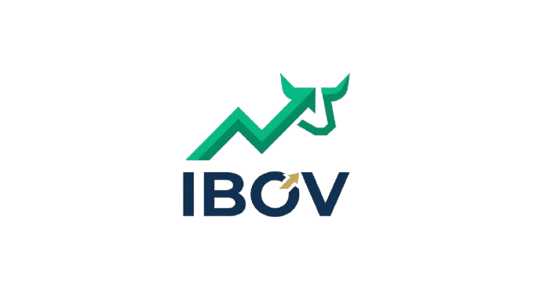

# Dashboard IBOV

Dashboard interativo para analisar ações da B3, montar uma carteira personalizada e comparar seu desempenho com o Ibovespa.



## Funcionalidades

- Seleção de ações brasileiras da carteira teórica IBrA
- Definição de período inicial e final para análise
- Configuração personalizada dos pesos da carteira
- Configuração da taxa livre de risco anual
- Comparação da carteira com o índice IBOV
- Cálculo de retorno, volatilidade e índice de Sharpe
- Visualização de alocação, correlação e risco/retorno
- Histórico de preços e exportação dos dados em CSV
- Interface responsiva com tema escuro

## Tecnologias

- Python
- Streamlit
- Pandas
- NumPy
- Plotly
- yfinance

## Estrutura do projeto

```text
DASHBOARD-IBOV/
|-- app.py
|-- config.TOML
|-- tickers_ibra.csv
|-- Img/
|   `-- IBOV.png
`-- README.md
```

## Como executar

### 1. Acesse a pasta do projeto

```powershell
cd PYTHON\DASHBOARD-IBOV
```

### 2. Crie e ative um ambiente virtual

```powershell
python -m venv .venv
.venv\Scripts\Activate.ps1
```

Caso o PowerShell bloqueie a ativação, execute:

```powershell
.venv\Scripts\activate.bat
```

### 3. Instale as dependências

```powershell
python -m pip install streamlit pandas numpy plotly yfinance
```

### 4. Inicie a aplicação

```powershell
streamlit run app.py
```

A aplicação será aberta no navegador, normalmente em `http://localhost:8501`.

## Como usar

1. Selecione uma ou mais empresas no menu lateral.
2. Informe o período de análise.
3. Ajuste a taxa livre de risco anual, se necessário.
4. Defina os pesos dos ativos na seção da carteira.
5. Navegue pelas abas para analisar desempenho, alocação, risco, ativos e dados.

Os pesos informados são normalizados automaticamente para representar 100% da carteira.

## Métricas calculadas

- **Retorno da carteira:** valorização acumulada no período selecionado.
- **Retorno do IBOV:** valorização do índice no mesmo período.
- **Volatilidade anualizada:** oscilação dos retornos calculada com 252 pregões por ano.
- **Índice de Sharpe:** retorno excedente em relação à taxa livre de risco por unidade de volatilidade.
- **Correlação:** relação entre os retornos dos ativos e do Ibovespa.

## Origem dos dados

As cotações são obtidas pelo `yfinance` a partir do Yahoo Finance. A lista de empresas disponível na barra lateral é carregada do arquivo `tickers_ibra.csv`.

> Os dados e as análises possuem finalidade educacional e não representam recomendação de investimento.

---

# IBOV Dashboard

Interactive dashboard for analyzing Brazilian stock-market assets, creating a custom portfolio and comparing its performance with the Ibovespa index.


## Features

- Brazilian B3 stock selection from the IBrA index
- Custom initial and end dates
- Custom portfolio weights
- Configurable annual risk-free rate
- Portfolio comparison with the IBOV index
- Return, volatility and Sharpe ratio calculations
- Allocation, correlation and risk/return visualizations
- Price history and CSV export
- Responsive dark-theme interface

## Technologies

- Python
- Streamlit
- Pandas
- NumPy
- Plotly
- yfinance

## Project structure

```text
DASHBOARD-IBOV/
|-- app.py
|-- config.TOML
|-- tickers_ibra.csv
|-- Img/
|   `-- IBOV.png
`-- README.md
```

## How to run

### 1. Enter the project folder

```powershell
cd PYTHON\DASHBOARD-IBOV
```

### 2. Create and activate a virtual environment

```powershell
python -m venv .venv
.venv\Scripts\Activate.ps1
```

If PowerShell blocks activation, run:

```powershell
.venv\Scripts\activate.bat
```

### 3. Install dependencies

```powershell
python -m pip install streamlit pandas numpy plotly yfinance
```

### 4. Start the application

```powershell
streamlit run app.py
```

The application will open in your browser, typically at `http://localhost:8501`.

## How to use

1. Select one or more companies in the sidebar.
2. Enter the analysis period.
3. Adjust the annual risk-free rate if needed.
4. Set asset weights in the portfolio section.
5. Browse the tabs to analyze performance, allocation, risk, assets and data.

The weights entered by the user are automatically normalized to represent 100% of the portfolio.

## Calculated metrics

- **Portfolio return:** cumulative appreciation during the selected period.
- **IBOV return:** index appreciation during the same period.
- **Annualized volatility:** return fluctuation calculated using 252 trading days per year.
- **Sharpe ratio:** excess return over the risk-free rate per unit of volatility.
- **Correlation:** relationship between asset and Ibovespa returns.

## Data source

Market prices are obtained with `yfinance` from Yahoo Finance. The company list in the sidebar comes from `tickers_ibra.csv`.

> Data and analysis are provided for educational purposes and do not constitute investment recommendations.
